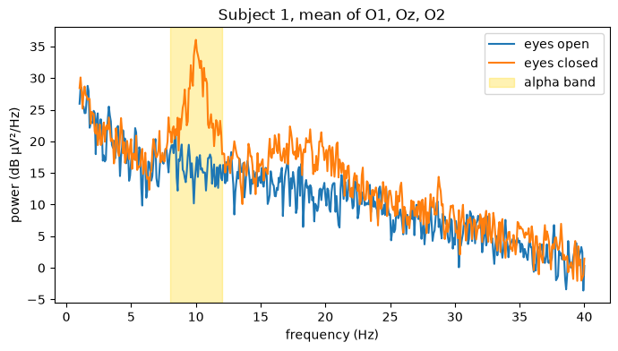
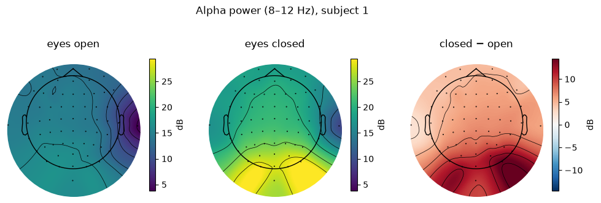
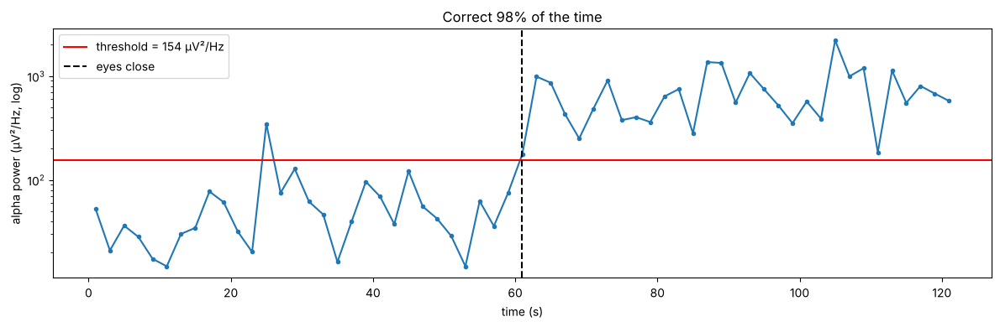
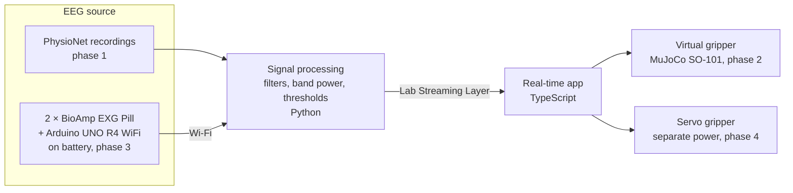

# diy-eeg-bci

[](https://github.com/Emeric-FullStack/diy-eeg-bci/actions/workflows/ci.yml)

[](LICENSE)
[](hardware/LICENSE)

> **FR** : Interface cerveau-machine « fait maison ». Objectif : ouvrir et fermer une pince, virtuelle puis réelle, par l'EEG, de façon fiable. On part de données EEG publiques, puis on passe à un capteur 2 canaux sur Arduino. Projet d'apprentissage : je ne me contente pas de lancer des scripts, chaque notebook est un banc d'essai dont je tourne les boutons, et chaque séance est racontée dans [`docs/log/`](docs/log/), erreurs et blocages compris.

A do-it-yourself brain-computer interface, built and documented step by step.

This is a learning project. The notebooks are not demos to run once: each one is a test bench with a few constants at the top that I change to see what moves, and every session is written up in [`docs/log/`](docs/log/), including what I got wrong and what finally made it click. If you are learning EEG from scratch, start with the [learning path](#learning-path) below.

**Goal #1: open and close a gripper with EEG, reliably.** First a virtual gripper, then a real one. Everything else waits until that works.

The project starts from public EEG recordings, moves to a simulated real-time chain, then to a low-cost biosignal amplifier ([BioAmp EXG Pill](https://github.com/upsidedownlabs/BioAmp-EXG-Pill)) on an Arduino UNO R4 WiFi.

## First result: the alpha rhythm

When you close your eyes, the visual cortex at the back of the head starts oscillating at about 10 Hz. Finding this effect is the sanity check for the whole analysis pipeline.





With eyes closed, power in the 8–12 Hz band over the occipital electrodes is about 16 times higher, with a peak at 10 Hz (subject 1 of the PhysioNet dataset). The difference map puts the effect at the back of the head, over the visual cortex.
Full analysis: [`analysis/01_eyes_open_vs_closed.ipynb`](analysis/01_eyes_open_vs_closed.ipynb).

## Second result: a one-bit brain switch

Two averages hide a curve. Gluing the eyes-open and eyes-closed minutes together and measuring alpha power every 2 seconds shows the rhythm switching on the moment the eyes close:



A threshold halfway between the two conditions classifies 98 % of the windows correctly. One false positive around 25 s shows the main enemy of any BCI: a command fired when nothing was asked. Notebook: [`analysis/02_alpha_over_time.ipynb`](analysis/02_alpha_over_time.ipynb).

## Learning path

Each notebook answers one question and ends with knobs to turn. Read them in order; the log entry linked next to each one tells how the session actually went.

| Notebook | Question | What I took away | Session |
|---|---|---|---|
| [`00_what_is_a_spectrum`](analysis/00_what_is_a_spectrum.ipynb) | What does a spectrum show? | A 10 Hz wave is 10 peaks per second and one spike at 10 Hz. Noise raises the floor but never moves a spike; the spectrum finds a wave the eye can no longer see. Band power turns the curve into one number. | [2026-10-28](docs/log/2026-10-28-what-is-a-spectrum.md) |
| [`01_eyes_open_vs_closed`](analysis/01_eyes_open_vs_closed.ipynb) | Can we find the alpha rhythm in real EEG? | ×16 more 8–12 Hz power with eyes closed over O1/Oz/O2, ×4 over C3/C4: the effect is born at the back of the head. It varies a lot between subjects. | [2026-10-27](docs/log/2026-10-27-phase-1-eyes-open-closed.md), [2026-10-28](docs/log/2026-10-28-what-is-a-spectrum.md) |
| [`02_alpha_over_time`](analysis/02_alpha_over_time.ipynb) | Does it switch on and off reliably? | Yes: a threshold on band power per window is a brain switch, 98 % correct here. Window length trades errors against reaction time. | [2026-10-29](docs/log/2026-10-29-alpha-over-time.md) |

Honest note: notebook 01 was first written and run by an AI assistant, and I could not explain its result. Notebook 00 exists because of that: a synthetic signal whose answer is known in advance. The ×16 only made sense once I had built it myself from a sine and some noise, then seen it as a curve in notebook 02.

## Architecture

Target design. Only the PhysioNet analysis exists today; the rest will be refined phase by phase.



## Roadmap

Each phase ends with a milestone; the next one starts only when it is reached.

| Phase | Goal | Status |
|---|---|---|
| 0 | Environment and repository | Done |
| 1 | Read signals: sampling, filters, spectra, alpha and mu bands (PhysioNet) | In progress |
| 2 | Simulated chain: real-time processing, Lab Streaming Layer, virtual gripper in MuJoCo | Planned |
| 3 | First real signal: BioAmp EXG Pill + Arduino, artefacts, electrode contact, electrical safety | Planned |
| 4 | Brain commands: alpha switch, SSVEP, calibration, success rate | Planned |
| 5 | Mu-rhythm training: motor imagery, event-related desynchronisation | Planned |

## Repository layout

```
analysis/       Python notebooks exploring the PhysioNet recordings
docs/log/       Project log, one entry per work session
docs/img/       Figures used in this README
hardware/       Wiring diagrams and 3D files
scripts/        Project checks (run by CI)
data/           Local recordings, not versioned
```

Added with their phase: `app/` (phase 2, TypeScript real-time application) and `firmware/` (phase 3, Arduino code).

`hardware/case/` holds a draft enclosure for the electronics. It is on hold until the boards arrive and can be measured: see its [README](hardware/case/README.md).

## Reproduce

You need Python 3.12 and Git.

```bash
git clone https://github.com/Emeric-FullStack/diy-eeg-bci.git
cd diy-eeg-bci
python -m venv .venv                 # Windows: py -3.12 -m venv .venv
source .venv/Scripts/activate        # macOS/Linux: source .venv/bin/activate
pip install -r requirements.txt
```

Then open a notebook in `analysis/` with VS Code or `jupyter lab`. MNE downloads the PhysioNet files to `~/mne_data` on first run (about 2.5 MB per recording), so they never end up in the repository.

To check that every notebook still runs from top to bottom (CI runs the same script on each push):

```bash
bash scripts/check.sh
```

## Project log

Every work session gets an entry in [`docs/log/`](docs/log/): goal, result, what I learned and next step. It is the best place to follow the project, failures included.

## Safety

The measurement side (electrodes, amplifier, Arduino) always runs on battery and is never connected to mains or to a computer by cable: the signal travels over Wi-Fi. Motors have their own board and power supply. The setup only measures; it never sends current into the body.

This is a learning project, not a medical device.

## Data and references

EEG recordings: [EEG Motor Movement/Imagery Dataset](https://physionet.org/content/eegmmidb/1.0.0/) (PhysioNet, ODC-By 1.0), 109 subjects, 64 channels, 160 Hz.

- Schalk, G., McFarland, D. J., Hinterberger, T., Birbaumer, N., Wolpaw, J. R. (2004). BCI2000: a general-purpose brain-computer interface (BCI) system. *IEEE Transactions on Biomedical Engineering*, 51(6), 1034–1043.
- Goldberger, A. L., et al. (2000). PhysioBank, PhysioToolkit, and PhysioNet: components of a new research resource for complex physiologic signals. *Circulation*, 101(23), e215–e220.

Analysis built with [MNE-Python](https://mne.tools/).

## License

Code under the [MIT License](LICENSE). Hardware designs in `hardware/` under the [CERN Open Hardware Licence v2 – Permissive](hardware/LICENSE).
