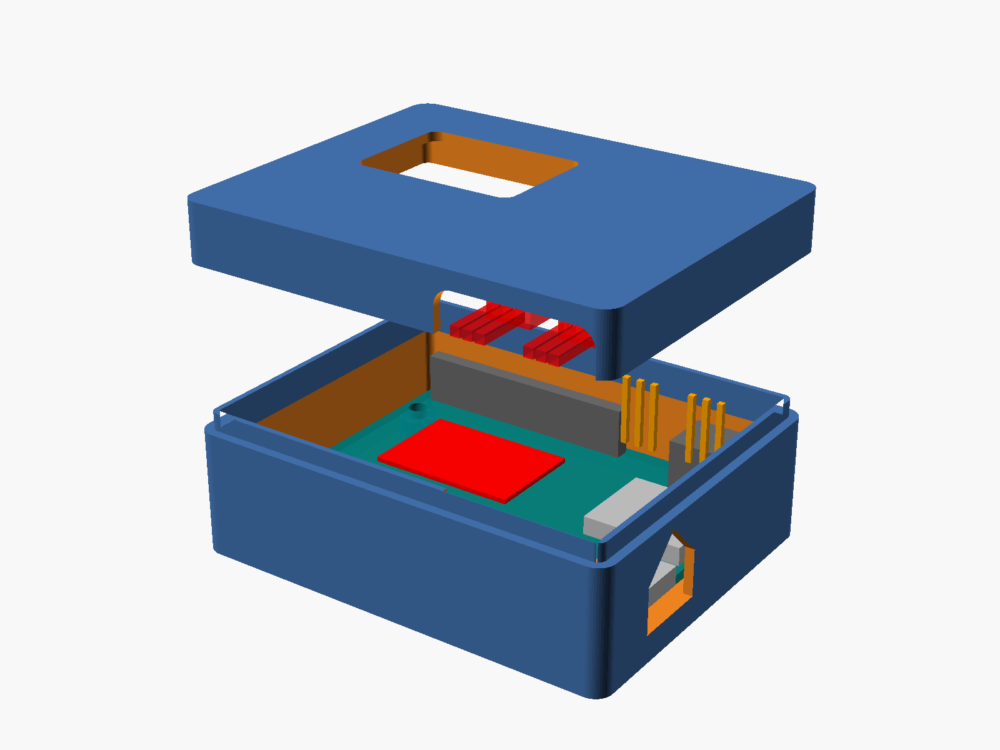

# EEG headset case — Arduino UNO R4 WiFi + 2 × BioAmp EXG Pill

Parametric two-part enclosure, written in OpenSCAD, for the electronics of our
EEG headset. It is meant to be worn on the head, so it is kept as small and
light as the parts allow (about 34 g in PLA with the default parameters).

**Status: draft, not yet validated against real hardware.** Several dimensions
are estimates (see [Parameters](#parameters)). No STL is published until the
boards have been measured; `preview.png` and `preview_print.png` show the
current state of the model.



## What is inside

| Part | Dimensions (default parameters) | Role |
|---|---|---|
| `base` | 74.8 × 59.5 × 24.2 mm (incl. 3 mm lip) | Carries the Arduino UNO R4 WiFi on four bosses, short M3 self-tapping screws. USB-C window on the X = 0 wall. Optional Qwiic window. |
| `lid` | 74.8 × 59.5 × 10.0 mm | Carries the two BioAmp EXG Pills in two U-shaped pockets moulded under the top plate. Window over the 12×8 LED matrix. Slot for the six electrode cables. |

Closed, the case is 74.8 × 59.5 × 31.2 mm. The lid slides over a 3 mm lip on
the base; there is no screw between the two parts for now (friction fit — add
tape or a strap if it proves too loose on the head).

### Layout

- Coordinates: origin at the outer bottom-left corner of the base, Z up, mm.
  X runs along the long side of the Arduino, with the **USB-C on the X = 0
  wall**. These are the same axes as the Arduino datasheet drawing.
- The Arduino sits on 4 bosses (`standoff_h` = 4 mm) at the standard UNO hole
  pattern, with 1.5 mm of clearance to the walls (USB-C and DC jack overhang
  the PCB by 1.3 mm).
- The two BioAmp pills are clipped **component side down** into the lid
  pockets, above the Arduino, on the USB-C side of the box (X ≈ 3–28 mm) so
  they never cover the LED matrix. Their JST PH connectors face the +Y wall,
  where the cable slot is. `cable_margin` (15 mm) is kept free between the
  JST housings and the inner face of that wall for the plugs and the cable
  bend. The OUT/GND/VCC castellations face −Y, towards the analog/power
  header of the Arduino, for short wires.
- The LED-matrix window is cut in the lid top plate; set `led_diffuser_t`
  (e.g. 0.6 mm) to print a thin diffusing membrane instead of an open hole.
- The USB-C window is a "house" shape (45° roof) in the base wall so that it
  prints without support.
- The electrode slot is a notch in the lid skirt, open towards the base; the
  base lip is cut away under it. Cables rest on the base rim.
- `headset_mount()` is an empty module: the attachment to the headset is
  deliberately left as a placeholder (`mount_type = "none"`) until the
  support has been measured.

### Printing

Both parts print without supports in PLA or PETG, 1.6 mm walls (4 perimeters
with a 0.4 mm nozzle, no infill needed), 0.2 mm layers:

- `base`: print as modelled (floor on the bed).
- `lid`: print upside down (top plate on the bed). `part = "lid"` and
  `part = "print"` already show it in that orientation.

The retention nubs under the pill PCBs are 0.4 mm bridges printed at a wall
tip; set `nub = 0` if your printer does not like them (the pills are then held
by friction and the cable plugs).

## Usage

Open `eeg_case.scad` in OpenSCAD (tested with 2021.01) and use the Customizer
or edit the variables at the top of the file.

| `part` | Shows |
|---|---|
| `"assembly"` | Closed case, ghost components (`show_components`), optional `explode` |
| `"print"` | Both parts side by side in print orientation |
| `"base"` / `"lid"` | One part, in print orientation |

Command-line previews (what produced the PNGs in this folder):

```sh
openscad -o preview.png --imgsize=1600,1200 --viewall --autocenter \
        --camera=0,0,0,65,0,215,0 -D 'explode=28' eeg_case.scad
openscad -o preview_print.png --imgsize=1600,1000 --viewall --autocenter \
        --camera=0,0,0,55,0,25,0 -D 'part="print"' eeg_case.scad
```

To export STLs once the dimensions are validated:

```sh
openscad -o base.stl -D 'part="base"' eeg_case.scad
openscad -o lid.stl  -D 'part="lid"'  eeg_case.scad
```

The file contains `assert()` checks that stop the render with a message if a
parameter change makes the parts collide (pills over the LED window, cable
slot into the top plate, USB window into the lip, …).

## Parameters

All dimensions are in millimetres. **Bold** rows are estimates flagged
`À MESURER` (to measure) or `À VÉRIFIER` (to check) in the source: they must
be confirmed on the real parts before an STL is exported.

### Arduino UNO R4 WiFi (datasheet ABX00087, §13)

| Variable | Default | Meaning |
|---|---|---|
| `ard_l`, `ard_w`, `ard_t` | 68.58, 53.34, 1.6 | PCB outline and thickness |
| `ard_holes` | (13.97, 2.54) (15.24, 50.80) (66.04, 7.62) (66.04, 35.56) | Mounting holes, from the bottom-left PCB corner (standard UNO pattern) |
| `ard_hole_d` | 3.2 | Hole diameter (4 × R1.6) |
| `ard_header_h` | 8.5 | Female header height |
| **`ard_comp_h`** | 11.0 | Tallest component above the PCB (DC jack) — to measure |
| **`usb_y`** | 37.9 | USB-C centre along the X = 0 edge — to check (derived from the drawing: 0.73 + 6.4 + 3.88 = 11.01 below the top edge, CX90B-16P width 8.94) |
| `usb_w`, `usb_h`, `usb_overhang` | 8.94, 3.26, 1.3 | USB-C receptacle |
| **`usb_cut_w`, `usb_cut_h`** | 13, 8 | USB-C window (size of your cable's overmould) — to measure |
| **`led_center`, `led_size`** | (46.2, 19.0), 25.8 × 17.5 | LED matrix position/extent, from the bottom-left PCB corner — to check (±1 mm, measured on the datasheet topology view) |
| `led_window_margin` | 1.5 | Window margin around the matrix |
| `led_diffuser_t` | 0 | 0 = open window; > 0 = printed diffusing membrane thickness |
| `qwiic_cut`, **`qwiic_y`**, `qwiic_cut_w`, `qwiic_cut_h` | false, 13.8, 9, 6 | Optional Qwiic window on the X = `ard_l` wall |

### BioAmp EXG Pill (KiCad sources, rev 1.0)

| Variable | Default | Meaning |
|---|---|---|
| `pill_l`, `pill_w`, `pill_t`, `pill_r` | 25.4, 10.0, 1.6, 1.0 | PCB outline (Edge.Cuts), thickness, corner radius |
| `pill_pin_pitch` | 2.54 | Castellated pads, 3 per end, centred on the width |
| **`pill_comp_h`** | 6.0 | Tallest part on the component side (JST housing); 8.5 if a 2.54 mm header is soldered pins-down — to measure |
| **`pill_back_h`** | 0.8 | Clearance for the back-side 0603s and solder jumpers (≈ 0.6 mm, ≥ 1.8 mm from the long edges) — to measure |
| **`jst_w`, `jst_len`, `jst_h`** | 7.9, 6.0, 6.0 | JST PH 2.0 mm 3-pin side-entry housing — to measure |
| **`jst_overhang`** | 2.0 | How far the JST housing sticks out past the PCB edge — to measure |
| `cable_margin` | 15 | Free space in front of the JST housings for plug and cable bend |

### Case

| Variable | Default | Meaning |
|---|---|---|
| `wall`, `floor_t`, `top_t` | 1.6, 1.6, 1.6 | Wall, floor and top-plate thickness |
| `corner_r` | 3 | Outer vertical corner radius |
| **`pcb_clear`** | 1.5 | Arduino PCB to inner wall clearance — to measure |
| `standoff_h`, `boss_d` | 4, 6.5 | Arduino bosses |
| **`screw_pilot_d`**, `screw_depth` | 2.5, 5 | Pilot hole for M3 self-tapping screws (2.5–2.8 depending on printer) — to measure |
| **`wire_clear`** | 3 | Gap between the tallest Arduino part and the underside of the pills (≥ 14 if Dupont housings run under the pills) — to measure |
| **`pill_clear`** | 0.3 | Clearance around the pill PCB in its pocket — to measure |
| `pocket_wall`, `ledge_w` | 1.2, 1.0 | Pocket wall thickness, back-side support ledge |
| `nub`, `nub_h` | 0.4, 0.6 | Retention nubs under the pill PCB (0 disables) |
| `jst_pass_clear` | 0.5 | Side clearance for the JST through the pocket end wall |
| `lip_h`, `lip_t`, **`fit_clear`** | 3, 0.8, 0.15 | Base/lid lip and its fit clearance — to measure |
| `pill_block_x` | 1.3 | Pocket block offset from the X = 0 wall (must clear the lip) |
| `slot_w`, `slot_extra_h` | 26, 1 | Electrode cable slot width, height above the JST plugs |
| `mount_type`, `mount_params` | "none", [] | Headset attachment — placeholder, to measure |

Derived values (`z_split`, `z_pill_bot`, outer size, …) are echoed in the
console at each render.

## Source dimensions

- **Arduino UNO R4 WiFi**: *Arduino UNO R4 WiFi datasheet* (ABX00087),
  §4.1 "Board Topology" and §13 "Mounting Holes And Board Outline",
  <https://docs.arduino.cc/resources/datasheets/ABX00087-datasheet.pdf>
  (revision dated 21/10/2026). Board 68.58 × 53.34 mm, holes 4 × R1.6 at
  (13.97, 2.54), (15.24, 50.80), (66.04, 7.62), (66.04, 35.56), header height
  8.5 mm, 2 × 1.3 mm connector overhang. The USB-C position and the LED-matrix
  footprint are not dimensioned in the datasheet: they were scaled off the
  drawings and are flagged for checking.
- **BioAmp EXG Pill**: `hardware/BioAmp-EXG-Pill.kicad_pcb` in
  <https://github.com/upsidedownlabs/BioAmp-EXG-Pill> (commit `86bb1f4`,
  2024-08-23, board rev 1.0, 2023-04-27). Outline 25.40 × 10.00 mm
  (Edge.Cuts 110.94–136.34 × 89.46–99.46), 1.6 mm thick, R1.0 corners, three
  castellated/through-hole pads at 2.54 mm pitch on each short edge, centred
  on the width; TSSOP-14 and all passives on the front, a few 0603s and the
  solder jumpers on the back. The KiCad sources do not include the JST PH
  connector that ships on the production boards, so its size is estimated
  from the JST PH side-entry family and flagged `À MESURER`.
  The BioAmp EXG Pill hardware itself is © Upside Down Labs, licensed
  CERN-OHL-S v2; only board dimensions were read from it, nothing is copied
  into this design.

## Licence

This enclosure design (`eeg_case.scad`, the preview images and this README)
is released under the **CERN Open Hardware Licence Version 2 – Permissive
(CERN-OHL-P v2)**. See [`../LICENSE`](../LICENSE) for the full text.

SPDX-License-Identifier: CERN-OHL-P-2.0
